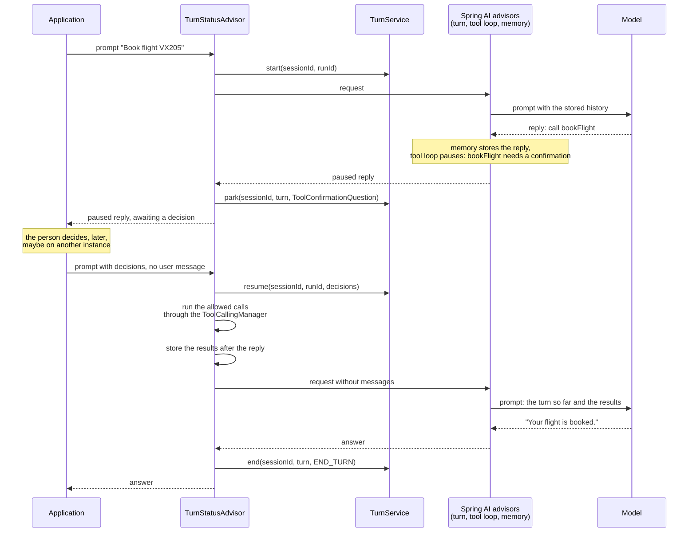
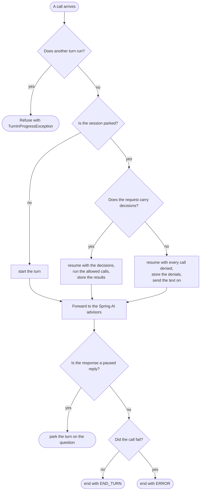

# Turns in the ChatClient

`spring-ai-session-turn-advisor` runs every `ChatClient` call as a turn, with the [turn service](turn-status.md).
It starts the turn before the call and ends it after.
When the tool loop pauses on a tool call that needs a confirmation, it parks the turn instead of ending it.
A later call with the person's decisions resumes it, on any instance.

## Using it

`TurnAdvisors` builds the advisor chain: the Spring AI session advisors, and the two advisors of this module around them.

```java
ChatClient chatClient = ChatClient.builder(chatModel)
    .defaultAdvisors(TurnAdvisors.builder(sessionService).build())
    .defaultTools(tools)
    .build();
```

A call names its session, as with the Spring AI session advisors.
When it pauses on a tool call, the response names the calls that await a decision, and the session is parked:

```java
ChatResponse response = chatClient.prompt()
    .user("Book flight VX205")
    .advisors(SessionAdvisors.session(sessionId))
    .call()
    .chatResponse();

List<String> awaiting = ToolCallDecisions.awaitingDecision(response);   // ["c1"]; empty when the call did not pause
```

Later, on any instance, a call with the person's decisions and no user message resumes it:

```java
ToolCallDecisions decisions = ToolCallDecisions.of(ToolCallDecision.allow("c1"));

chatClient.prompt()
    .advisors(TurnStatusAdvisor.decisions(sessionId, decisions))
    .call()
    .content();
```

`TurnStatusAdvisor.decisions` sets the session id and the decisions in the advisor context.
The request must carry the tools of the allowed calls.
Tools set with `defaultTools` are on every request.
Tools passed to a single call must be passed again with the decisions.

The module uses these context keys:

| Context key | Value |
|---|---|
| `session_tool_call_decisions` (`TOOL_CALL_DECISIONS_CONTEXT_KEY`) | The `ToolCallDecisions` that answer the parked tool calls. |
| `session_run_id` (`RUN_ID_CONTEXT_KEY`) | The run id of the turn. `TurnStatusAdvisor.runId(runId)` sets it; the advisor sets it on the response. See [the run id](#the-run-id). |
| `session_turn_id` (`TURN_ID_CONTEXT_KEY`) | The id of the turn. The advisor sets it on the request it forwards, for the interrupt check. You do not set it. |

## The run id

Each call runs as a turn under a [run id](turn-status.md#the-run-id).
The advisor takes it from the request context under `session_run_id`, or generates one.
It puts the run id into the context of the request it forwards and of the response.

`TurnStatusAdvisor.runId(runId)` sets the run id for a call that starts a turn and for one that resumes it:

```java
chatClient.prompt()
    .user("Book flight VX205")
    .advisors(SessionAdvisors.session(sessionId))
    .advisors(TurnStatusAdvisor.runId("run-1"))
    .call()
    .content();
```

A resume without a run id runs under a new one.
To keep the run id of the paused call, pass it with the decisions.
The run id is stored in the session's log, so the status of a parked session still has it, on any instance and after a restart:

```java
TurnService turns = new TurnService(sessionService);
String runId = turns.status(sessionId).runId();   // the run id of the parked turn

chatClient.prompt()
    .advisors(TurnStatusAdvisor.decisions(sessionId, decisions))
    .advisors(TurnStatusAdvisor.runId(runId))
    .call()
    .content();
```

The paused response has the same run id in its context, under `TurnStatusAdvisor.RUN_ID_CONTEXT_KEY`, for a caller that still holds it.

## It wraps the Spring AI advisors

Spring AI 2.1 already has session advisors for the `ChatClient`.
This module does not replace them.
It adds one advisor in front of them and one behind them, and leaves them as they are.

<div class="diagram">
--8<-- "docs/assets/images/turn-advisors.svg"
</div>

A lower order runs further out.
The `ToolCallingAdvisor` runs the advisors after it again for each tool round, so the `SessionMemoryAdvisor` stores every round.
The `TurnInterruptAdvisor` runs on every round too, before the model is called.
The `TurnStatusAdvisor` and the `SessionTurnAdvisor` run once per call.
So the `TurnStatusAdvisor` sees the whole call, and it sees the response after the Spring AI advisors stored it.

The `TurnStatusAdvisor` does three things the Spring AI advisors do not:

- **It records the turn.** `start` before the call, `end` after, `park` when the response is a paused reply.
- **It resumes a parked turn from decisions.** The request carries the person's decisions and no user message.
- **It closes a pause when new text arrives.** See [new text on a parked session](#new-text-on-a-parked-session).

## A paused tool call and its resume

Two calls.
The first one pauses on a tool that needs a confirmation.
The second one carries the decisions and finishes the turn.



On the resume, the `TurnStatusAdvisor` stores the tool results right after the paused reply, and forwards the request without messages.
Spring AI's turn advisor sees that the open calls have results and leaves them alone.
Spring AI's memory advisor builds the prompt from the log, so the model gets the whole turn.
When an allowed call's tool returns directly, its result is the answer, and the model is not called.

## Asking the person

The paused response names the calls that await a decision.
An application that still holds it can ask the person at once.
Another instance, or the same one after a restart, reads the question from the session's log instead:

```java
TurnService turns = new TurnService(sessionService);

SessionEvent pending = turns.pendingQuestion(sessionId);   // null when the session waits on nothing
ToolConfirmationQuestion question = ToolConfirmationQuestion.from(pending);

for (ToolConfirmationQuestion.ToolCall call : question.toolCalls()) {
    // call.name() and call.arguments() are what to show the person
    // call.awaitingDecision() tells whether the person must decide on it
}
```

The answer has one decision for each call, named by `call.key()`:

```java
List<ToolCallDecision> decisions = question.toolCalls().stream()
    .map(call -> !call.awaitingDecision() || approved(call)
            ? ToolCallDecision.allow(call.key())
            : ToolCallDecision.deny(call.key(), "The user declined the booking."))
    .toList();

chatClient.prompt()
    .advisors(TurnStatusAdvisor.decisions(sessionId, new ToolCallDecisions(decisions)))
    .call()
    .content();
```

`approved` stands for what the person chose.
A call that does not await a decision needs no confirmation, so the example allows it.

`ToolConfirmationQuestion.from` refuses a question of another kind.
When your harness also parks on questions of its own, read the kind first, with `Question.from(pending).kind()`.

## When the tools run

A paused reply can hold several tool calls, and only some of them may need a confirmation.

- **No call of a paused reply runs before the resume.** Spring AI checks the whole reply before it runs any call. When one call needs a confirmation, none runs, also not the calls that need none.
- **The decisions cover every call of the reply.** A call that needs no confirmation still needs a decision, because it has not run yet.
- **A denied call does not run.** Its result is the message of the denial, and the model reads it.
- **An allowed call runs once, on the resume.** The advisor records the answer first, then runs the calls, then stores the results. A second call with the same decisions is refused, because the question already has its answer.
- **The tool calls of earlier rounds already ran.** A turn can run several tool rounds before one of them pauses. Their results are in the log, and the resume does not touch them.

Decisions name the calls by key, not the question they answer.
When the turn has parked again on a new question, decisions made for the old one are refused because their keys do not match the new reply.
A model that sends no tool call ids gets position keys (`#0`, `#1`), and there old decisions can match the calls of the new question.

### When a resume fails

The answer is recorded before the tools run.
So an allowed call runs at most once, and a failure never runs it a second time.

- **The run of the allowed calls fails.** The turn ends with `ERROR`. Every call of the reply gets the result "No result was recorded for this tool call.", so the log keeps no call without a result.
- **The instance dies during the resume.** The turn stays `RUNNING`, and another resume is refused. A tool may have run without its result in the log. Free the session with `TurnService.interrupt`. On the next call, Spring AI's turn advisor gives the calls without a result the same "No result was recorded" result.

## What the `TurnStatusAdvisor` decides on each call



### Refused requests

These requests are refused, and nothing is written:

| Request | Exception |
|---|---|
| Any call while another turn runs on the session | `TurnInProgressException` |
| Decisions on a session that is not parked, or that does not exist | `IllegalStateException` |
| Decisions on a session parked on a question of another kind, or whose paused reply is no longer its newest message | `IllegalStateException` |
| Decisions for a question another caller answered first | `IllegalStateException`, or `TurnInProgressException` while that caller's turn runs |
| Decisions together with a user message | `IllegalArgumentException` |
| Decisions that miss a call of the paused reply, or name a call it does not have | `IllegalArgumentException` |
| An allowed call whose tool the request does not carry | `IllegalArgumentException` |

An `IllegalArgumentException` means the request is wrong.
An `IllegalStateException` means the session is not in a state for it.

### New text on a parked session

New text always moves a parked session on.
The person did not decide, so the advisor closes the question before the text goes on:

- **The session waits on the tool confirmation of its newest reply.** The advisor stores a denial for each open tool call, with the text of `TurnStatusAdvisor.ABANDONED_DENY_MESSAGE`. The log then says the calls were denied, not that they have no result.
- **The session waits on a question of another kind, or the log changed since it parked.** The question gets an empty answer, and no tool runs.

## Interrupting a running call

`TurnService.interrupt(sessionId, reason)` ends the running turn at once, from a stop button or another instance.
The session is then free for the next turn.

The interrupted call must stop too.
Otherwise its tool loop goes on, and its messages land in between those of the next turn.
The `TurnInterruptAdvisor` stops it.
Before each model round it checks that the call's turn still runs, and throws `TurnInterruptedException` when it does not.
The rounds that already ran stay in the log, with their tool results.

```java
try {
    chatClient.prompt().user("...").advisors(SessionAdvisors.session(sessionId)).call().content();
}
catch (TurnInterruptedException ex) {
    // ex.getStatus().stopReason() is INTERRUPTED
}
```

With `stream()` the exception is the error signal of the `Flux`.
The failed call does not change the status: it stays as the interrupt left it.
The check is one indexed read per model round.
A tool that already runs is not stopped: the loop stops before the next model round.
`TurnAdvisors` adds the advisor by default, and `interruptible(false)` leaves it out.

## Configuring the advisors

`TurnAdvisors` builds the whole chain at the right orders.
The settings the advisors share are set once, so they cannot differ.

```java
ChatClient chatClient = ChatClient.builder(chatModel)
    .defaultAdvisors(TurnAdvisors.builder(sessionService)
        .sessionIdInToolContext(true)
        .sessionAdvisors(session -> session.compaction(trigger, strategy))
        .build())
    .build();
```

| Setting | What it does |
|---|---|
| `sessionIdInToolContext(true)` | Tools get the session id in their tool context. It applies to the calls of the loop and to the allowed calls of a resume alike. |
| `toolCallingManager(manager)` | The manager that runs the allowed calls of a resume. Use the one the `ChatClient`'s tool-calling advisor uses. |
| `scheduler(scheduler)` | The scheduler for the session calls of a streamed call, for every advisor. |
| `interruptible(false)` | Leaves the `TurnInterruptAdvisor` out. |
| `sessionAdvisors(session -> ...)` | The settings of the Spring AI session advisors, compaction for example. |

You can also build the three parts yourself, with `TurnStatusAdvisor.builder`, `SessionAdvisors.builder` and `TurnInterruptAdvisor.builder`.

## Streaming

A streamed call works the same way.
A streamed pause ends on a last chunk that names the calls awaiting a decision, and the advisor parks the turn when the stream completes.
A stream that fails ends the turn with `ERROR`.
A stream the client cancels ends it with `CANCELLED`, also when the client leaves while the turn is still starting.
A client that cancels after the last chunk does not change the outcome: the turn is parked or ended as the stream finished.
The session calls run on a scheduler, never on the model's thread, and a cancel never interrupts them.
