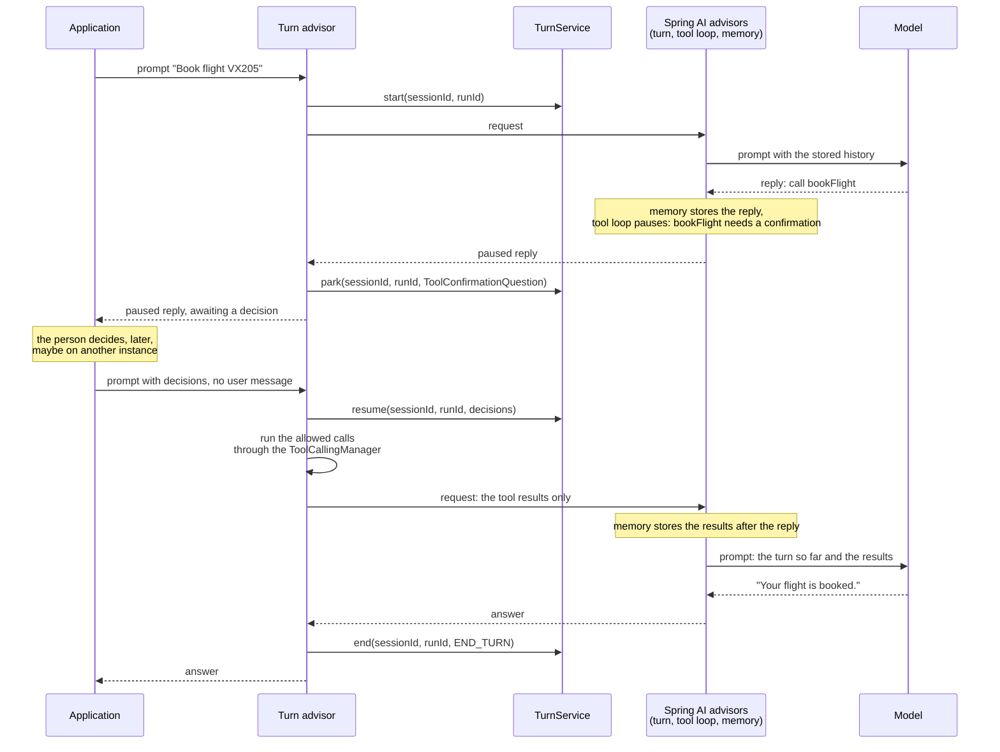
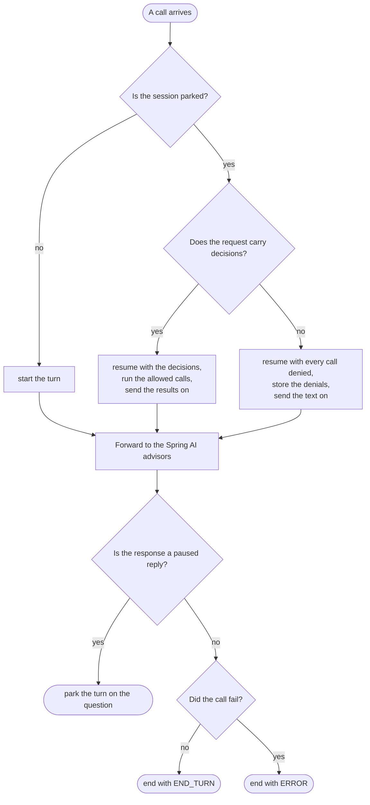

# Turns in the ChatClient

!!! note "Planned"
    This page describes the design of `spring-ai-session-turn-advisor`. The module is not built yet. The [turn service](turn-status.md) it uses is available.

`spring-ai-session-turn-advisor` runs every `ChatClient` call as a turn.
It starts the turn before the call and ends it after.
When the tool loop pauses on a tool call that needs a confirmation, it parks the turn instead of ending it.
A later call with the person's decisions resumes it, on any instance.

## It wraps the Spring AI advisors

Spring AI 2.1 already has session advisors for the `ChatClient`.
This module does not replace them.
It adds one advisor in front of them and leaves them as they are.

| Advisor | Order | Runs |
|---|---|---|
| The turn advisor of this module | `HIGHEST_PRECEDENCE + 100` | Once per call, first |
| Spring AI `SessionTurnAdvisor` | `HIGHEST_PRECEDENCE + 200` | Once per call: creates the session, compacts |
| Spring AI `ToolCallingAdvisor` | `HIGHEST_PRECEDENCE + 300` | The tool loop: runs tools, pauses on a confirmation |
| Spring AI `SessionMemoryAdvisor` | `HIGHEST_PRECEDENCE + 1000` | Once per model call: stores the messages, builds the prompt |

A lower order runs further out.
So the turn advisor sees the whole call, and it sees the response after the Spring AI advisors stored it.

The turn advisor does three things the Spring AI advisors do not:

- **It records the turn.** `start` before the call, `end` after, `park` when the response is a paused reply.
- **It resumes a parked turn from decisions.** The request carries the person's decisions and no user message.
- **It closes a pause when new text arrives.** It stores a denial for each open tool call before the text goes on. The log then says the calls were denied, not that they have no result.

## A paused tool call and its resume

Two calls.
The first one pauses on a tool that needs a confirmation.
The second one carries the decisions and finishes the turn.

On the resume, the turn advisor sends the tool results as the request.
Spring AI's turn advisor sees that the open calls have results and leaves them alone.
Spring AI's memory advisor stores the results right after the reply, and the model gets the whole turn.

## What the turn advisor decides on each call

A request with decisions on a session that is not parked is refused.
A busy session, one on which another turn runs, refuses the call with `TurnInProgressException`.

## Still to work out

- How the stream path detects a paused reply.
- A tool marked `returnDirect` that runs after a resume.
- Tool call limits that count the rounds before the pause.
- The names of the context keys. They will start with `session_`.
