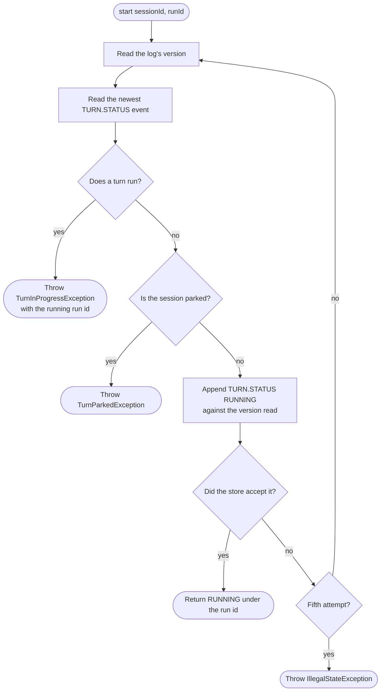
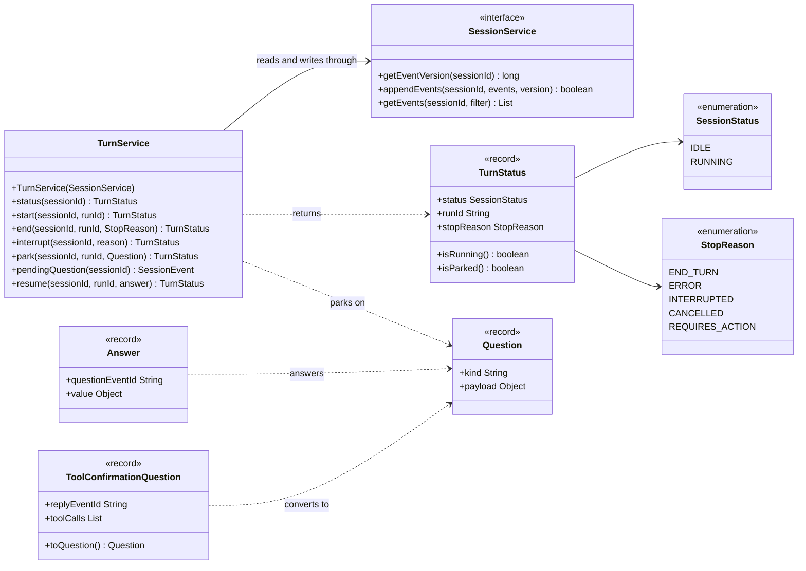
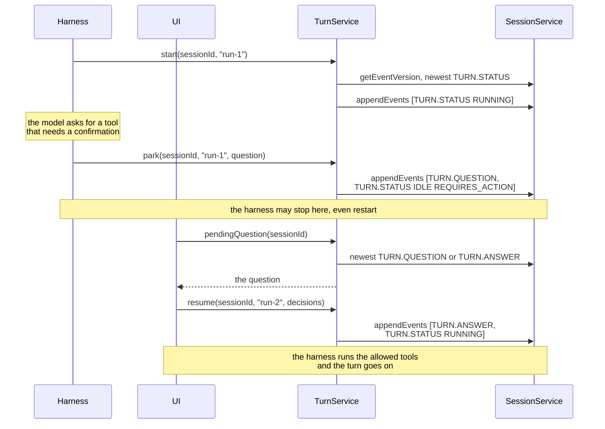

# Turn Status

A turn is one piece of work a harness does on a session: from a user's message to the model's last answer, with every tool call in between.
`spring-ai-session-turn` records in the session's log whether a turn runs, under which run id, and why the last one ended.

This solves three problems that a plain conversation log has:

- **Two harnesses can run one session at the same time.** Two instances, or two browser tabs, append their messages in between each other's. With a turn status, the second one is refused.
- **A running turn cannot be stopped from elsewhere.** A stop button on another instance has nothing to write to. With a turn status, it records an interrupt that the running harness reads.
- **A turn that waits for a person is lost on a restart.** A tool call that needs a confirmation pauses the turn, and the pause lives only in memory. With a turn status, the question is in the log, and any instance can resume the turn with the answer.

The module works with any Spring AI session store, because it uses only what every store has: events of its own type, a read by type, and a version-checked append.

## Using it

```java
TurnService turns = new TurnService(sessionService);

TurnStatus turn;
try {
    turn = turns.start(sessionId, runId);
}
catch (TurnInProgressException ex) {
    return busy(ex.getRunId());                     // another turn runs: refuse, a 409 for example
}
catch (TurnParkedException ex) {
    return ask(turns.pendingQuestion(sessionId));   // the session waits for an answer
}

try {
    // run the turn: call the model, run tools, append messages
    turns.end(sessionId, turn.runId(), StopReason.END_TURN);
}
catch (RuntimeException ex) {
    turns.end(sessionId, turn.runId(), StopReason.ERROR);
    throw ex;
}
```

`busy` and `ask` stand for what your application does.
A refused start writes nothing and owns no turn.
That is why it stays outside the second `try`: there is no turn to end.

From anywhere else, a UI or another instance:

```java
turns.status(sessionId);                          // RUNNING under run-7, or IDLE with a stop reason
turns.interrupt(sessionId, "user pressed stop");  // ends the running turn
```

`TurnService` keeps no state. It reads and writes through the `SessionService`, so you can create one per call or keep one.

## What the log holds

Every change is an event in the session's log.

| Event type | Written when | Payload |
|---|---|---|
| `TURN.STATUS` | A turn starts or ends | `status`, `runId`, `stopReason` |
| `TURN.INTERRUPT` | Someone asks the running turn to stop | `reason` |
| `TURN.QUESTION` | A turn stops to wait for an answer | `kind`, `value` |
| `TURN.ANSWER` | The answer arrives and the turn goes on | `questionEventId`, `value` |

None of these events carries a message.
The session's active view holds message events only, so these events never reach a prompt, and a compaction never covers them.
They stay in the log as the record of the session's turns.

The status of a session is its newest `TURN.STATUS` event.
A session without one is `IDLE`.
There is no status column and no second store: the log is the only source.

## Status and stop reasons

A session is `RUNNING` while a turn runs, and `IDLE` otherwise.
An idle session tells why its last turn ended:

| Stop reason | Meaning |
|---|---|
| `END_TURN` | The turn ran to its end. |
| `ERROR` | The turn failed. |
| `INTERRUPTED` | Someone called `interrupt`. A `TURN.INTERRUPT` event sits right before it. |
| `CANCELLED` | The client stopped listening, a cancelled stream for example. Nobody asked the session to stop, so there is no `TURN.INTERRUPT` event. |
| `REQUIRES_ACTION` | The turn is parked on a question and waits for an answer. |

## How a change is written

Every method that changes the status follows the same steps.
It reads the log's version, then the current status, and decides.
Then it appends its events with the version it read.
If another writer appended in between, the store refuses the append, and the method reads again and decides again.
After five refused attempts it gives up with an `IllegalStateException`.

This is what makes two concurrent starts safe: both read the same version, both try to append, and the store accepts exactly one.

The activity of `start`:



`end`, `interrupt`, `park` and `resume` follow the same loop with their own decision:

- **`end`** writes only when the turn runs under the caller's run id. Otherwise it writes nothing and returns the status as it stands. So a late end never overwrites a later turn, and an interrupt that landed first stands.
- **`interrupt`** writes the `TURN.INTERRUPT` event and, when a turn runs, the `TURN.STATUS` event that ends it, in one append.
- **`park`** and **`resume`** are described below.

## The types



`SessionService` is Spring AI's interface. `TurnEventTypes` holds the four event types, and `SessionStatusEvents` and `QuestionEvents` build and read the events. The diagram leaves those helpers out.

## A turn that waits for a person

A turn can stop to ask a person something and go on later with the answer, on any instance, after any delay.
The first kind of question is a tool call that needs a person's confirmation.

- **`park`** writes a `TURN.QUESTION` event and a `TURN.STATUS` event `IDLE` with `REQUIRES_ACTION`, in one append. The session is then parked. It holds no turn while the person thinks.
- **`pendingQuestion`** returns the open question: the newest `TURN.QUESTION` event when no `TURN.ANSWER` follows it.
- **`resume`** writes a `TURN.ANSWER` event that points at the question, and a `TURN.STATUS` event `RUNNING`, in one append. Only a parked session resumes, so the same answer sent twice resumes once.
- **`start`** on a parked session throws `TurnParkedException`. A new turn would leave the question open.

`ToolConfirmationQuestion` is the shape for a tool confirmation: the event id of the stored reply, and its tool calls with the ones that wait for a decision. The answer is Spring AI's `ToolCallDecisions`.

A harness parks a turn and a UI resumes it:



## What it does not do

- **No lease.** A turn whose harness died stays `RUNNING` until someone calls `interrupt`, which ends it. A later version can add a lease that lets the next start take over a turn that ran too long.
- **One answer per question.** The answer decides every tool call of the question at once. An application that collects decisions one by one holds them until it has all.
- **No stop by itself.** An interrupt changes the status. The harness that runs the turn learns of it only when it reads the status, between two model calls for example.
- **No transaction around it.** Run the turn service outside a surrounding transaction. Inside one with repeatable read isolation, the version read does not see what another writer committed, and every attempt fails.
